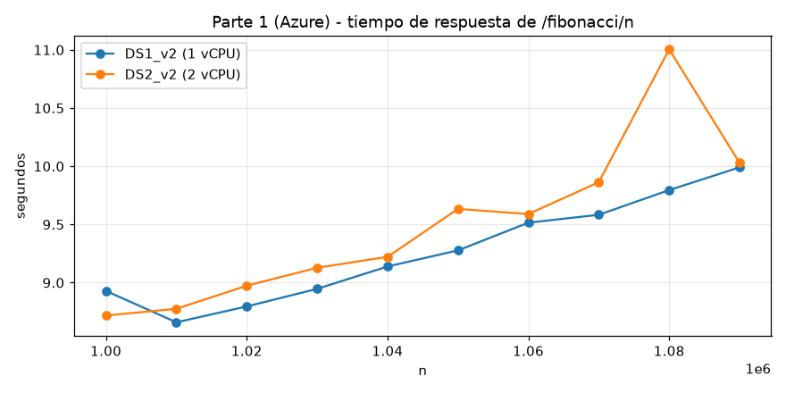
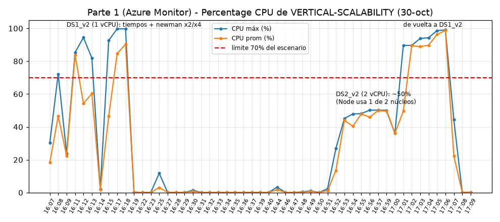
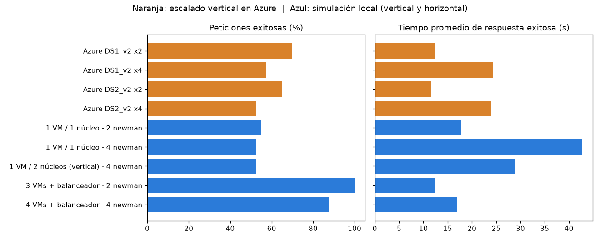
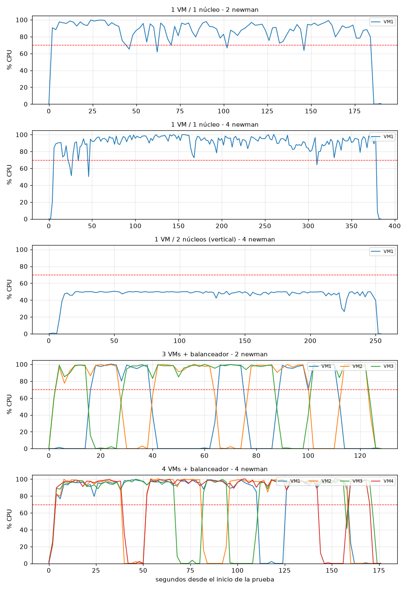
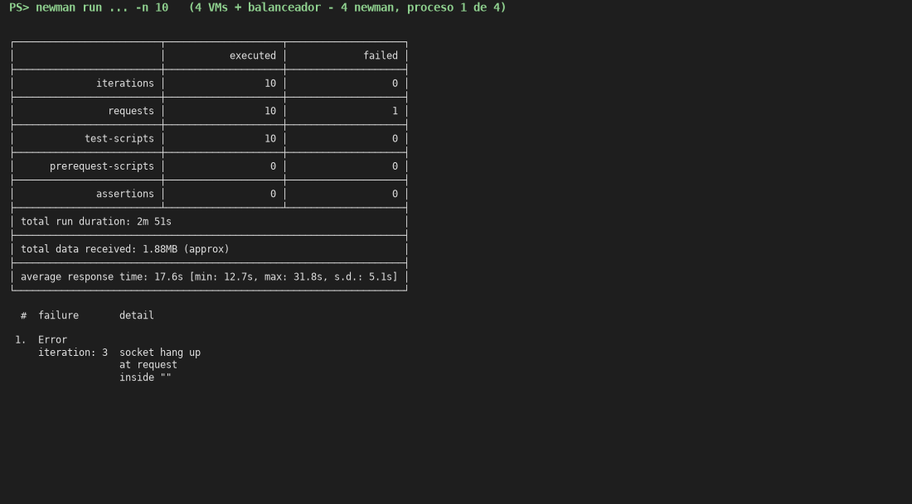
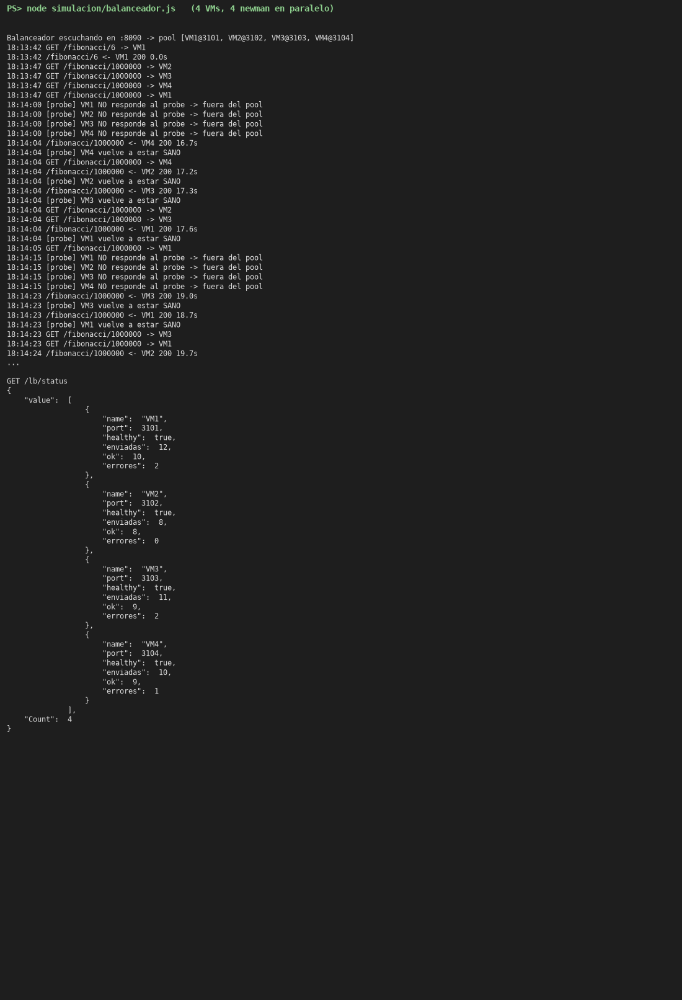
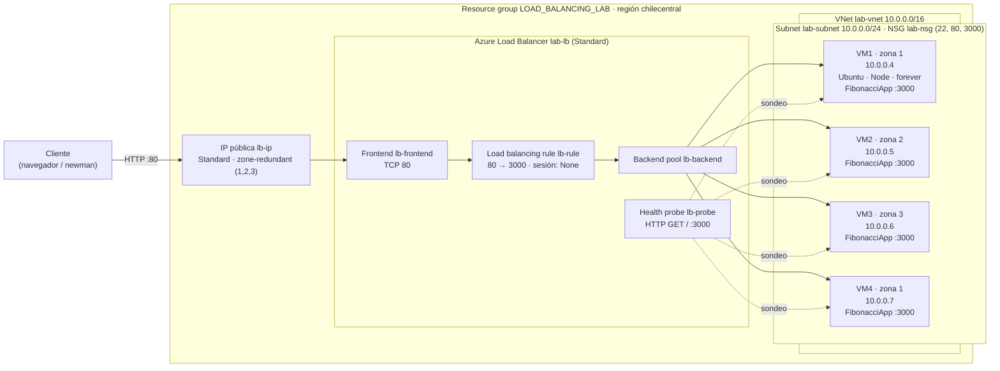
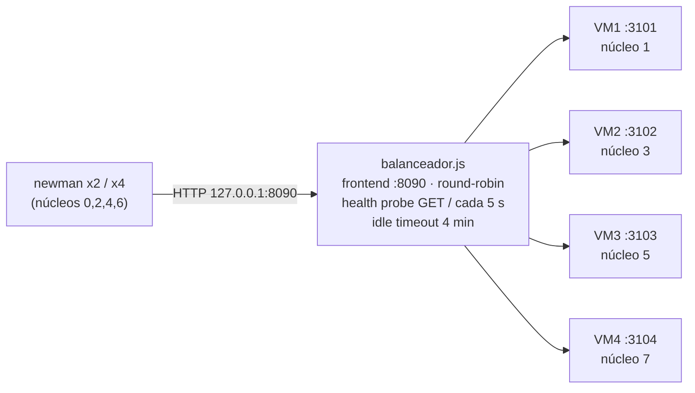

### Escuela Colombiana de Ingeniería – Arquitecturas de Software (ARSW)
## Laboratorio 9 – Escalamiento vertical y horizontal (Azure)

**Autor:** Juan Diego Melo

> **Nota sobre el entorno.** La Parte 1 se hizo en **Azure** (grupo `SCALABILITY_LAB`, región `chilecentral`).
> Como la región y la suscripción *Azure for Students* no ofrecían los tamaños `B1ls`/`B2ms`, se usaron sus equivalentes
> `Standard_DS1_v2` (1 vCPU, 3.5 GiB) y `Standard_DS2_v2` (2 vCPU, 7 GiB).
> En la Parte 2 se alcanzó a crear en Azure el balanceador, la VNet, el NSG, el backend pool y VM1
> (evidencia en [`results/azure_evidencia/infraestructura_azure.txt`](results/azure_evidencia/infraestructura_azure.txt)),
> pero **se agotaron los créditos** y la suscripción quedó deshabilitada (`ReadOnlyDisabledSubscription`): no se pudo
> crear VM2–VM4. Por eso la Parte 2 se reprodujo **en local** con la misma arquitectura (ver [Parte 2](#parte-2--escalabilidad-horizontal)).

### Estructura del repositorio

| Ruta | Contenido |
|---|---|
| `FibonacciApp/` | Aplicación (solo se cambió el puerto para que sea configurable con `PORT`, por defecto 3000) |
| `results/scripts/` | Scripts usados en Azure: `tiempos.sh` (paso 7), `carga.sh` (newman en paralelo), `cpu.sh` (métrica de Azure Monitor), `parte2_infra.sh` + `parte2_cloud-init.yaml` (infraestructura de la Parte 2 con Azure CLI), `resumen_newman.py`, `graficas.py` |
| `results/newman/` | Reportes de newman de la Parte 1 (Azure) |
| `results/cpu/`, `results/parte1_tiempos_*.csv` | CPU (Azure Monitor) y tiempos de respuesta de la Parte 1 |
| `simulacion/` | Parte 2 en local: `balanceador.js` (Load Balancer) y `prueba.ps1` (levanta las VMs, el balanceador, lanza newman y mide CPU) |
| `results/simulacion/` | Reportes de newman, CPU por VM y bitácora del balanceador de cada prueba local |
| `images/resultados/` | Gráficas y capturas |

---

## Parte 1 – Escalabilidad vertical (Azure)

Se creó la VM `VERTICAL-SCALABILITY` (Ubuntu Server, usuario `scalability_lab`, llave SSH), se instaló Node con nvm,
se clonó el repositorio, se abrió el puerto 3000 con una *Inbound port rule* y se dejó la app corriendo con `forever`.
`http://<ip>:3000/fibonacci/6` → `The answer is 8`. Para las pruebas posteriores también se publicó la app en el puerto 80.

**1. ¿Cuántos y cuáles recursos crea Azure junto con la VM?**
Además de la VM se crean **5 recursos** (6 en total):

| Recurso | Nombre |
|---|---|
| Máquina virtual | `VERTICAL-SCALABILITY` |
| Disco administrado (SO) | `VERTICAL-SCALABILITY_disk1_…` |
| Interfaz de red (NIC) | `VERTICAL-SCALABILITYVMNic` |
| Dirección IP pública | `VERTICAL-SCALABILITYPublicIP` |
| Red virtual (con su subred) | `VERTICAL-SCALABILITYVNET` |
| Grupo de seguridad de red | `VERTICAL-SCALABILITYNSG` |

**2. ¿Para qué sirve cada recurso?**
* **VM:** el cómputo (vCPU + RAM) donde corre Ubuntu y la FibonacciApp.
* **Disco:** almacenamiento persistente del sistema operativo y la app; sobrevive a reinicios y a cambios de tamaño.
* **NIC:** conecta la VM a la subred; tiene la IP privada y se asocia con la IP pública y el NSG.
* **IP pública:** dirección con la que se llega a la VM desde Internet (SSH y la app).
* **VNet/Subnet:** red privada aislada en Azure; da direccionamiento privado y comunicación entre recursos.
* **NSG:** firewall con reglas de entrada/salida (puerto, protocolo, origen, prioridad) para la NIC/subred.

**3. ¿Por qué se cae la app al cerrar SSH? ¿Por qué hace falta la *Inbound port rule*?**
El proceso `node FibonacciApp.js` es hijo de la shell de la sesión SSH. Al cerrar la conexión la shell termina y
envía `SIGHUP` a sus procesos hijos, que mueren. Por eso se usa `forever` (o `pm2`, `nohup`, un servicio `systemd`),
que desacopla el proceso de la terminal y además lo reinicia si se cae.
La regla de entrada es necesaria porque el NSG, por defecto, **niega todo el tráfico entrante desde Internet** salvo lo
permitido explícitamente (al crear la VM solo se abrió el 22). Sin una regla que permita TCP 3000 los paquetes se
descartan antes de llegar a la VM.

**4. Tabla de tiempos e interpretación** ([`results/parte1_tiempos_*.csv`](results/), medidos con `curl`, `tiempos.sh`)

| n | DS1_v2 (1 vCPU) s | DS2_v2 (2 vCPU) s | Tamaño de la respuesta |
|---|---|---|---|
| 1 000 000 | 8.93 | 8.72 | 209 002 B |
| 1 010 000 | 8.66 | 8.78 | 211 092 B |
| 1 020 000 | 8.80 | 8.97 | 213 182 B |
| 1 030 000 | 8.95 | 9.13 | 215 271 B |
| 1 040 000 | 9.14 | 9.22 | 217 361 B |
| 1 050 000 | 9.28 | 9.63 | 219 451 B |
| 1 060 000 | 9.51 | 9.59 | 221 541 B |
| 1 070 000 | 9.58 | 9.86 | 223 631 B |
| 1 080 000 | 9.79 | 11.00 | 225 721 B |
| 1 090 000 | 9.99 | 10.03 | 227 811 B |
| **Promedio** | **9.26** | **9.49** | |



La función tarda tanto porque hace `n-1` sumas con `big-integer` (librería en JavaScript puro, no nativa).
El número de Fibonacci 1 000 000 tiene **~209 000 dígitos** (eso mide la respuesta), así que cada suma recorre
cientos de miles de dígitos y el costo total es aproximadamente cuadrático (n × dígitos ≈ 10¹¹ operaciones),
además de crear un objeto nuevo en cada iteración (presión sobre el *garbage collector*) y de convertir el
resultado a texto. No se reutiliza nada entre peticiones (no hay memoización) y todo corre en el único hilo de Node.

**5. Consumo de CPU** (Azure Monitor, métrica *Percentage CPU*, [`results/cpu/`](results/cpu/))



Con DS1_v2 la CPU sube a **85–100 %** mientras hay peticiones: el cálculo es 100 % CPU-bound (no hay E/S que esperar)
y ocupa por completo el único vCPU. Con DS2_v2 la CPU se queda en **~50 %**: Node ejecuta el JavaScript en **un solo
hilo**, así que solo puede usar uno de los dos núcleos; el otro queda ocioso. En ambos casos se supera el 70 % del
escenario de calidad (en DS2_v2 el núcleo que trabaja está al 100 %).

**6. Resumen de newman** ([`results/newman/`](results/newman/))

| Prueba (Azure) | Exitosas | Tiempo prom. | Tiempo máx. | Errores |
|---|---|---|---|---|
| DS1_v2, 2 newman en paralelo | 14/20 (70 %) | 12.4 s | 16.3 s | 6 × ECONNRESET |
| DS1_v2, 4 newman en paralelo | 23/40 (58 %) | 24.3 s | 39.6 s | 17 × ECONNRESET |
| DS2_v2, 2 newman en paralelo | 13/20 (65 %) | 11.6 s | 16.5 s | 7 × ECONNRESET |
| DS2_v2, 4 newman en paralelo | 21/40 (52 %) | 23.9 s | 39.9 s | 19 × ECONNRESET |

* **Tiempos:** una petición sola tarda ~9 s; con 2 clientes concurrentes el promedio sube a 12 s y con 4 a 24 s
  (máx. ~40 s). Node atiende una petición a la vez: las demás esperan en cola a que termine la anterior, así que el
  tiempo de respuesta crece linealmente con la concurrencia.
* **Fallos:** todos son `ECONNRESET` (el servidor cierra la conexión TCP). Newman reutiliza la conexión *keep-alive*
  entre iteraciones y Node cierra las conexiones ociosas tras `keepAliveTimeout` (5 s). Mientras el *event loop* está
  bloqueado calculando la petición de otro cliente, ese cierre se ejecuta tarde, justo cuando el cliente ya envió la
  siguiente petición por esa conexión → la conexión se resetea y la petición se pierde. Es decir, los fallos son
  consecuencia directa de que el único hilo está saturado. **No se cumple** "todas las peticiones deben ser respondidas".

**7. Diferencia entre `B2ms` y `B1ls`**

| | B1ls | B2ms | (usados) DS1_v2 | DS2_v2 |
|---|---|---|---|---|
| vCPU | 1 | 2 | 1 | 2 |
| RAM | 0.5 GiB | 8 GiB | 3.5 GiB | 7 GiB |
| Rendimiento base de CPU | 5 % | 60 % (de 200 %) | 100 % (no burstable) | 100 % |
| Costo aprox. (Linux, pay-as-you-go) | ~US$4/mes | ~US$60/mes | ~US$53/mes | ~US$107/mes |

Más allá de vCPU/RAM, la serie **B es "burstable"**: la VM tiene un rendimiento base y acumula *créditos de CPU*
cuando está por debajo de él; los gasta para subir hasta el 100 % por ráfagas. Cuando se acaban, la CPU queda
limitada al rendimiento base. Con una carga sostenida 100 % CPU como esta, una B1ls agotaría los créditos y quedaría
al 5 %, mientras que la B2ms tiene una base mucho más alta, más memoria (la B1ls con 0.5 GiB queda muy justa para
Node + npm) y más ancho de banda/IOPS, a ~15 veces el precio. Las DS_v2 no son burstables: entregan siempre el 100 %.

**8. ¿Aumentar el tamaño es una buena solución? ¿Qué le pasa a la FibonacciApp?**
No. El cuello de botella es que Node usa un solo hilo: al pasar de 1 a 2 vCPU el tiempo por petición no cambió
(9.26 s vs 9.49 s) y la tasa de éxito tampoco mejoró; solo se pagó el doble por un núcleo que queda ocioso. Además,
para cambiar el tamaño Azure **detiene y reinicia la VM**: la FibonacciApp se cae durante el cambio y, como `forever`
no estaba configurado para arrancar con el sistema, hay que volver a lanzarla manualmente.

**9. ¿Qué pasa con la infraestructura al cambiar el tamaño? Efectos negativos**
La VM se apaga (y si el tamaño no está disponible en el host actual se desasigna y se mueve a otro hardware), se le
asignan los nuevos recursos y arranca de nuevo. Efectos negativos: **indisponibilidad** durante el reinicio
(minutos), pérdida de lo que hubiera en memoria y en el disco temporal, posible cambio de IP pública si es dinámica,
procesos que no vuelven solos, el costo crece y existe un **techo** (el tamaño más grande disponible). Sigue siendo
un único punto de falla.

**10. ¿Hubo mejora en CPU o tiempos?**
**No** en tiempos (≈9.3 s vs ≈9.5 s) ni en tasa de éxito. El porcentaje de CPU bajó a ~50 %, pero solo porque ahora
hay dos núcleos y la app sigue usando uno; no es una mejora real de capacidad.

**11. Con 4 ejecuciones paralelas, ¿el comportamiento es porcentualmente mejor?**
No: DS1_v2 → 58 % de éxito, DS2_v2 → 52 %; el tiempo promedio prácticamente se duplica respecto a 2 clientes en ambos
tamaños (24 s). La VM más grande no absorbe mejor la concurrencia.

**12. Evaluación del escenario de calidad:** con escalamiento vertical **no se cumple**: hay peticiones sin responder
y el núcleo que procesa está por encima del 70 %.

**13.** La VM se dejó en el tamaño inicial y luego se desasignó.

---

## Parte 2 – Escalabilidad horizontal

### Lo que se hizo en Azure

Con [`results/scripts/parte2_infra.sh`](results/scripts/parte2_infra.sh) (Azure CLI) se creó en `LOAD_BALANCING_LAB`:
el **Load Balancer Standard** `lab-lb` con IP pública *zone-redundant* `lb-ip`, el **backend pool** `lb-backend`, el
**health probe** HTTP `/` puerto 3000, la **load balancing rule** 80 → 3000, la **VNet** `lab-vnet` (10.0.0.0/16) con la
subnet `lab-subnet` (10.0.0.0/24), el **NSG** `lab-nsg` (22, 80, 3000), las NICs de VM1–VM3 asociadas al pool y la
**VM1** en la zona 1 (instalación automática con [`parte2_cloud-init.yaml`](results/scripts/parte2_cloud-init.yaml):
nvm + node + `git clone` + `forever start FibonacciApp.js`). La evidencia está en
[`results/azure_evidencia/infraestructura_azure.txt`](results/azure_evidencia/infraestructura_azure.txt).
Al intentar crear VM2 y VM3 Azure respondió `ReadOnlyDisabledSubscription`: **los créditos de la suscripción se
agotaron**, así que las pruebas de carga se hicieron con la simulación local.

### Simulación local de la infraestructura

Se reproduce la misma arquitectura en un PC con un Intel i7-10610U (4 núcleos físicos / 8 hilos):

| Azure | Simulación |
|---|---|
| VM de 1 vCPU con FibonacciApp | Proceso `node FibonacciApp.js` con **afinidad a un único núcleo físico** (VM1→núcleo 1, VM2→3, VM3→5, VM4→7), puerto 3101–3104 |
| Load Balancer (frontend :80, rule 80→3000, backend pool) | [`simulacion/balanceador.js`](simulacion/balanceador.js): frontend :8090, reparte en round-robin entre los nodos del pool |
| Health probe HTTP `/` | Sondeo `GET /` cada 5 s; un nodo sale del pool tras 2 fallos seguidos y vuelve al responder |
| Idle timeout de 4 min del LB | El balanceador cierra conexiones sin actividad durante 4 min |
| Percentage CPU (Azure Monitor) | % de CPU de cada proceso cada 2 s (100 % = el núcleo de esa VM ocupado) |
| Escalado vertical (resize) | Misma VM con afinidad a **2 núcleos** |

[`simulacion/prueba.ps1`](simulacion/prueba.ps1) levanta las VMs y el balanceador, lanza N newman en paralelo con la
colección del laboratorio (`-n 10`, `nth = 1000000`), mide la CPU y guarda todo en `results/simulacion/<prueba>/`.

**Para reproducirlo / grabar el video** (requiere Node y `npm install -g newman`; en `FibonacciApp/` correr `npm install`):

```powershell
# 4 VMs detrás del balanceador y 4 newman en paralelo; -Visible abre la consola del balanceador para verlo repartir
powershell -ExecutionPolicy Bypass -File .\simulacion\prueba.ps1 -Nodos 4 -Paralelos 4 -Etiqueta demo -Visible
# escalado vertical: 1 VM con 2 núcleos
powershell -ExecutionPolicy Bypass -File .\simulacion\prueba.ps1 -Nodos 1 -Nucleos 2 -Paralelos 4 -Etiqueta vertical
```

Mientras corre, `http://127.0.0.1:8090/fibonacci/6` responde `The answer is 8` y `http://127.0.0.1:8090/lb/status`
muestra cuántas peticiones recibió cada VM y si está sana.

**Validación de la simulación:** con 1 VM de 1 núcleo y 2 newman la simulación dio **11/20 exitosas con 9
`ECONNRESET`**, exactamente lo mismo que la DS1_v2 real en Azure (11/20, 9 `ECONNRESET`, prueba
`results/newman/p1_DS1_v2_x2`), y con 4 newman 21/40 con 19 `ECONNRESET`, igual que la DS2_v2 en Azure. El
comportamiento de la app es el mismo, así que las conclusiones de la parte horizontal son trasladables.

### Resultados

| Prueba | Exitosas | Tiempo prom. | Tiempo máx. | Duración | CPU por VM (prom / máx) |
|---|---|---|---|---|---|
| Azure DS1_v2 (1 vCPU), 2 newman | 14/20 (70 %) | 12.4 s | 16.3 s | 1 m 57 s | 85–99 % |
| Azure DS2_v2 (2 vCPU), 2 newman | 13/20 (65 %) | 11.6 s | 16.5 s | 1 m 50 s | ~45–50 % |
| Azure DS2_v2 (2 vCPU), 4 newman | 21/40 (52 %) | 23.9 s | 39.9 s | 2 m 50 s | ~45–50 % |
| Local 1 VM / 1 núcleo, 2 newman | 11/20 (55 %) | 17.8 s | 21.8 s | 3 m 08 s | 85 % / 100 % |
| Local 1 VM / 1 núcleo, 4 newman | 21/40 (52 %) | 42.7 s | 80.2 s | 6 m 25 s | 89 % / 100 % |
| Local 1 VM / **2 núcleos** (vertical), 4 newman | 21/40 (52 %) | 28.8 s | 47.9 s | 4 m 16 s | **46 % / 50 %** |
| **Local 3 VMs + balanceador, 2 newman** | **20/20 (100 %)** | **12.3 s** | 14.4 s | 2 m 07 s | VM1 45 %, VM2 65 %, VM3 73 % (máx. 100 %) |
| **Local 4 VMs + balanceador, 4 newman** | **35/40 (88 %)** | **16.9 s** | 31.9 s | 2 m 58 s | 71–77 % c/u (máx. 100 %) |

(Los tiempos locales son ~10 % más altos que en Azure porque una petición sola tarda ~10.5 s en este PC vs ~9 s en la VM.)



**CPU de cada VM en cada prueba local** (línea roja = 70 %):



**Capturas:** resumen de newman y bitácora del balanceador (4 VMs, 4 newman):





Para comparar, el resumen de newman con una sola VM y 4 clientes: [`newman_v1_1nucleo_x4.png`](images/resultados/newman_v1_1nucleo_x4.png).

### Informe de newman 1 (punto 2): vertical vs. horizontal

* **Tiempos de respuesta:** con una sola VM las peticiones concurrentes hacen cola detrás del único hilo de Node: con
  2 clientes el promedio es 12 s en Azure (18 s local) y con 4 sube a 24 s en Azure (43 s local, máx. 80 s). Con 3 VMs
  detrás del balanceador y 2 clientes cada petición cae en un nodo libre: **12.3 s promedio, prácticamente el tiempo de
  una petición aislada (~10.5 s) más el reparto**, y la prueba termina en 2 m 07 s frente a 3 m 08 s.
* **Peticiones exitosas:** vertical **52–70 %** (siempre con `ECONNRESET`, tanto en DS1_v2 como en DS2_v2);
  horizontal con 3 VMs **100 %** (0 errores) y con 4 VMs y el doble de clientes **88 %**.
* **CPU:** al escalar verticalmente a 2 núcleos la CPU queda en ~50 % (un núcleo al 100 % y el otro ocioso), sin
  mejorar nada. En horizontal cada VM usa su núcleo completo cuando tiene trabajo y queda en 0 % cuando no: la carga
  se reparte entre las máquinas.
* **Costos** (aprox., Linux pay-as-you-go, precios de referencia de East US; en `chilecentral` varían un poco):

  | Infraestructura | Recursos | Costo aprox. |
  |---|---|---|
  | Vertical | 1 × DS2_v2 (2 vCPU) + 1 IP pública | ≈ US$0.15/h ≈ **US$110/mes** |
  | Horizontal 3 nodos | 3 × DS1_v2 + LB Standard (≈US$0.025/h + US$0.005/GB) + IP Standard | ≈ US$0.25/h ≈ **US$180/mes** |
  | Horizontal 4 nodos | 4 × DS1_v2 + LB + IP | ≈ US$0.32/h ≈ **US$235/mes** |
  | (Enunciado) Horizontal con B1ls | 3 × B1ls + LB + IPs | ≈ **US$35/mes**, pero los B1ls se quedan sin créditos de CPU con esta carga |

  El esquema horizontal cuesta más por hora en este caso, pero es el único que **cumple** el requisito, tolera la caída
  de una VM o de una zona y se puede crecer/decrecer agregando o quitando nodos sin apagar el servicio. Gastar el doble
  en una VM más grande no compró nada porque la app no puede usar el segundo núcleo.

### Punto 3: 4 VMs y 4 newman en paralelo

El balanceador repartió 12/8/11/10 peticiones a VM1–VM4 y las cuatro VMs trabajaron al mismo tiempo, cada una con su
núcleo al ~100 % mientras atendía y con un promedio de 71–77 % durante la prueba (gráfica inferior de CPU). Comparado
con 1 VM y 4 clientes, la tasa de éxito pasó de **52 % a 88 %**, el tiempo promedio de **42.7 s a 16.9 s** y la prueba
duró la mitad (2 m 58 s vs 6 m 25 s).

**¿Por qué aumenta la tasa de éxito?** El problema de fondo es que una instancia de Node solo procesa una petición
costosa a la vez. Con escalado horizontal hay **N procesos independientes, cada uno con su propio hilo y su propio
núcleo**, y el balanceador envía cada petición nueva a una instancia distinta: las peticiones se atienden en paralelo
en lugar de hacer cola. Al no haber cola, el *event loop* de cada nodo no queda bloqueado mientras otro cliente espera,
y desaparecen los cierres de conexión *keep-alive* que provocaban los `ECONNRESET`. Los 5 fallos que quedan con 4 VMs
ocurren cuando el round-robin manda una petición a un nodo que todavía está ocupado (no sabe cuál está libre); además
el health probe marca a todos los nodos como caídos mientras calculan, porque no pueden contestar `GET /` (se ve en la
bitácora). Con 3 VMs para 2 clientes siempre hubo un nodo libre y el éxito fue del 100 %.

**Escenario de calidad:** con escalado horizontal y capacidad suficiente (3 VMs para 2 clientes) **todas las
peticiones se respondieron**. La CPU *por VM* sigue llegando a 100 % mientras calcula (cada petición ocupa un núcleo
entero, y ningún modelo de escalamiento cambia eso), pero la CPU promedio del sistema queda por debajo del 70 % (45–73 %
por VM con 3 nodos). Para cumplirlo también con 4 clientes hacen falta más nodos que clientes concurrentes (o un
algoritmo de reparto por "menos conexiones" en vez de round-robin); escalar horizontalmente lo permite simplemente
agregando VMs al backend pool, algo que con el escalado vertical no se logra.

### Preguntas

**¿Tipos de balanceadores de carga en Azure? ¿Qué es SKU? ¿Por qué el balanceador necesita una IP pública?**
* **Azure Load Balancer** (capa 4, TCP/UDP): reparte flujos por hash de 5-tupla (IP/puerto origen, IP/puerto destino,
  protocolo). Puede ser **público** (frontend con IP pública, recibe tráfico de Internet) o **interno/privado**
  (frontend con IP privada, para balancear dentro de la VNet, p. ej. entre capas de una aplicación). Es el que se usa en
  este laboratorio.
* **Application Gateway** (capa 7, HTTP/HTTPS): enruta por URL/host, termina TLS, afinidad por cookie y WAF.
* **Front Door** (capa 7, global): balanceo entre regiones con CDN, aceleración y WAF en el borde.
* **Traffic Manager** (DNS, global): responde con el endpoint más adecuado (prioridad, rendimiento, geografía).
* **Gateway Load Balancer:** inserta appliances virtuales de red (firewalls) de forma transparente.

**SKU** (*Stock Keeping Unit*) es el "nivel" del producto, que define capacidades, SLA y precio. En el Load Balancer:
**Basic** (gratis, hasta 300 instancias, solo VMs de un mismo availability set/scale set, sin zonas, sin SLA, abierto
por defecto; retirado en sept-2025) y **Standard** (hasta 1000 instancias, cualquier VM de la VNet, *zone-redundant*,
SLA 99.99 %, seguro por defecto —requiere NSG que permita el tráfico—, HTTPS probes, reglas de salida, métricas).
También hay SKU **Gateway**. Las IPs públicas tienen igualmente SKU Basic/Standard y deben coincidir con el del
balanceador. Se usó **Standard**.

El balanceador **público** necesita una IP pública porque es el único punto de entrada al sistema: los clientes de
Internet se conectan a esa IP (frontend) y el balanceador reenvía a las IPs privadas del backend pool. Así las VMs no
tienen que exponerse individualmente y se pueden agregar o quitar sin que el cliente cambie de dirección.

**¿Propósito del *Backend Pool*?** Es el conjunto de instancias (NICs/IPs de VMs o de un scale set) que reciben el
tráfico del balanceador. Escalar horizontalmente es agregar o quitar miembros del pool.

**¿Propósito del *Health Probe*?** Comprobar periódicamente (TCP, HTTP o HTTPS a un puerto/ruta, cada *intervalo*) si
cada instancia está sana. Si una instancia falla el número de sondeos configurado, deja de recibir flujos nuevos hasta
que vuelva a responder. Así el sistema tolera la caída de un nodo sin que el cliente lo note.

**¿Propósito de la *Load Balancing Rule*? ¿Tipos de sesión persistente?** La regla une un frontend (IP + puerto, aquí
80), un backend pool, un puerto de backend (3000), un protocolo y un health probe: define *qué tráfico* se reparte, *a
dónde* y *cómo*. Tipos de persistencia (*session persistence / distribution mode*):
* **None** (hash de 5-tupla, por defecto): cada flujo nuevo puede ir a una instancia distinta.
* **Client IP** (2-tupla: IP origen + IP destino): el mismo cliente va siempre a la misma instancia.
* **Client IP and protocol** (3-tupla): igual, pero distinguiendo el protocolo.

Importa cuando la aplicación guarda estado de sesión en memoria del servidor: sin persistencia el usuario podría
"perder" su sesión al caer en otro nodo. Pero afecta la escalabilidad: la carga deja de repartirse uniformemente (un
cliente o un NAT con muchos usuarios se pega a un nodo y lo sobrecarga), los nodos nuevos no reciben a los clientes ya
asignados y si el nodo cae la sesión se pierde igual. Lo ideal es que la aplicación sea *stateless* (estado en una
caché/BD compartida) y usar **None**, como la FibonacciApp.

**¿Qué es una *Virtual Network*, una *Subnet*, el *address space* y el *address range*?** La **VNet** es la red
privada y aislada de Azure donde se comunican los recursos (entre sí, con Internet y con redes on-premise). El
**address space** es el bloque de IPs privadas (CIDR) que la VNet puede usar (aquí `10.0.0.0/16`, 65 536 direcciones).
Una **subnet** es una partición de ese espacio con su propio **address range** (aquí `10.0.0.0/24`, 256 direcciones,
de las que Azure reserva 5); permite agrupar recursos, aplicarles un NSG o rutas y separar capas (web, datos, etc.).
Los rangos no deben solaparse con los de otras redes con las que se quiera conectar (peering/VPN).

**¿Qué son las *Availability Zones* y por qué 3 zonas? ¿Qué es una IP *zone-redundant*?** Una zona de disponibilidad
es uno o más datacenters físicamente separados dentro de una región, con energía, refrigeración y red independientes.
Poner VM1, VM2 y VM3 en las zonas 1, 2 y 3 hace que la falla de un datacenter completo solo tumbe un nodo: el health
probe lo saca del pool y los otros dos siguen atendiendo (SLA de 99.99 % para VMs en 2+ zonas). Una IP
**zone-redundant** se publica desde las tres zonas a la vez, así que sigue funcionando aunque una zona caiga (una IP
*zonal* vive en una sola zona y cae con ella).

**¿Propósito del *Network Security Group*?** Filtrar el tráfico de red hacia y desde los recursos de la VNet mediante
reglas priorizadas (origen, destino, puerto, protocolo, permitir/denegar), asociadas a la NIC o a la subred. Aquí se
permite 22 (SSH), 3000 (app, que es a donde el balanceador reenvía y donde llega el health probe) y 80; todo lo
demás entrante desde Internet se niega. Con el Load Balancer Standard es obligatorio, porque sin una regla que permita
el tráfico el balanceador no puede alcanzar las VMs.

**Informe de newman 1 (punto 2):** ver la sección [*Informe de newman 1*](#informe-de-newman-1-punto-2-vertical-vs-horizontal).

**Diagrama de despliegue de la solución (Azure)**



**Despliegue de la simulación local** (misma arquitectura, cada "VM" es un proceso fijado a un núcleo físico distinto):



